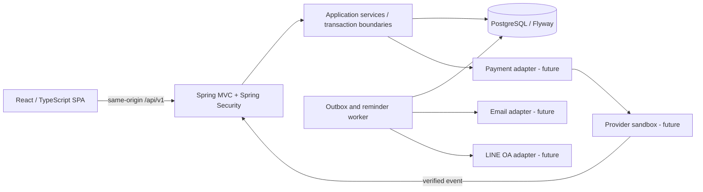
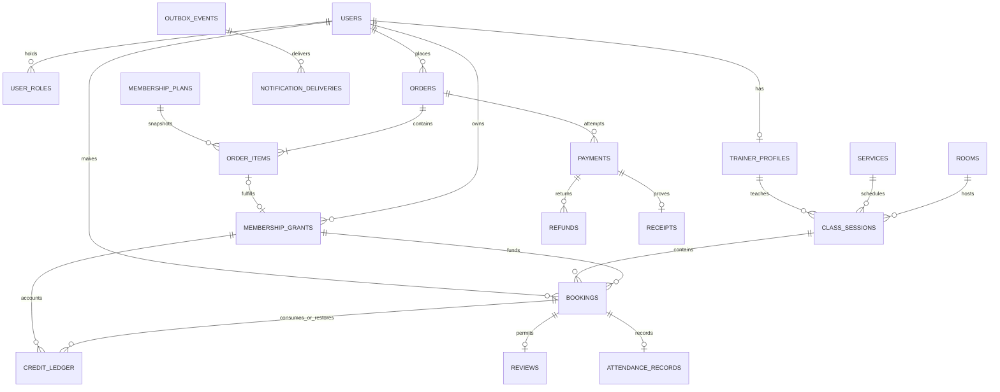

# Oasis Wellness Hub — Architecture

Status: **Implemented local application through workflow Phases 4–7**, updated 2026-10-27. The lower target-design sections are historical proposals; actual decisions here and the phase handoffs take precedence. Real payment, Email and LINE adapters remain unconfigured. See [PHASE4_7_HANDOFF.md](PHASE4_7_HANDOFF.md), [API.md](API.md) and [OPERATIONS.md](OPERATIONS.md).

## Current persistence and layering — JPA refactor

The user-authorized refactor supersedes the JdbcTemplate decisions in historical phase notes below. Current request path:

Subsequent approved Supabase reset: the user explicitly requested IF NOT EXISTS for every CREATE TABLE. V1–V6 were revised for all 28 creates, per-migration RLS and fixed trigger function search paths, then applied fresh to public on the verified hosted project. This supersedes older unchanged-checksum statements in the historical notes below. Public has 29 RLS-enabled tables including the Flyway-created history; JPA and API startup against it passed. Older local databases still require a separate checksum/adoption plan. No production runtime role hardening or deployment is implied.

```text
controller → service interfaces → service.impl → repository → JPA / PostgreSQL
                              DTO          business        ORM/native       models
```

- `config/`: SecurityConfig, PaymentConfiguration, NotificationConfiguration (including the conditional Worker) and the package-private SessionGuard helper. Bean methods, security rules, adapter defaults and worker properties are unchanged.
- `utils/`: Actor and TimeValues, with no nested feature packages.
- `component/`: ApiError advice, RequestTrace filter, AuthThrottle and the PaymentGateway/NotificationTransport integration contracts. These replace the former small shared/identity/payment/notification packages; implementations and configuration still live in their existing layers.
- `controller/`: all nine production REST controllers, retaining API paths, DTOs and service contracts. Security and adapter configuration live in `config/`; the guarded simulator controller remains test-only.
- `models/`: 28 JPA entities mapped to the existing V1–V6 tables, composite IDs, lazy read-only relation mappings, JSONB snapshots and immutable history mappings. There is no cascading financial-history deletion. Database constraints/triggers remain authoritative.
- `dto/`: HTTP requests/responses and gateway contracts; validation and JSON field names preserved. Controllers return DTOs, never persistence entities or lazy relation graphs. Session Principal stays separate from the public Me DTO.
- `service/`: 11 interfaces, including AccountService as UserDetailsService. Parameter constraints are declared on contracts once to preserve Bean Validation inheritance rules.
- `service/impl/`: 11 Spring service implementations owning authorization, business rules and transaction orchestration. Constructors depend on contracts/repositories. No SQL, JdbcTemplate or ResultSet APIs occur here.
- `repository/`: Spring Data JpaRepository stores and domain EntityManager repositories. ORM/JPQL implements user/roles, service and room CRUD, plan/eligibility replacement, availability/review inserts and inbox reads/read-state. Typed mapped session/booking/grant queries preserve exact native NO KEY UPDATE locks. Parameterized native queries handle PostgreSQL locks/upserts, immutable ledger/fulfillment operations, outbox leasing and aggregate projections. This is JPA persistence with deliberate native SQL, not a claim that every query is JPQL.
- Shared native-query support uses EntityManager/Tuple, normalizes temporal projections to Instant/LocalDate, binds every parameter and flushes/clears around bulk writes. Clearing prevents stale managed entities after guarded seat/credit/payment updates; row locks remain held until transaction completion.
- JpaTransactionManager is the sole business transaction manager. Existing @Transactional and TransactionTemplate boundaries are retained. Webhook verification and provider dispatch remain outside database locks. A new regression proves bulk context invalidation and rollback.
- Flyway still owns schema evolution. Existing migrations/checksums are unchanged; prod, the optional supabase profile and PostgreSQL tests use ddl-auto=validate, never automatic schema updates. The current user-edited dev profile uses ddl-auto=none. H2 remains a schema-free smoke fixture with Flyway/DDL disabled. Open-in-view is disabled and temporal JDBC binding is UTC beneath the JPA API.
- Optional `supabase` profile targets a pre-created private `oasis_app` schema: Flyway default/schema, Hibernate default schema, and JDBC search path are aligned. TLS is required and JPA validates all entity mappings. `public` remains on the search path for the existing btree_gist extension. Automatic baseline, schema creation and Flyway clean are disabled in this profile. The prepared bootstrap SQL creates an empty schema and denies PUBLIC/anon/authenticated schema access; hosted execution requires approval. Existing public data is not adopted/copied. The local private-schema rehearsal passed migration V1–V6, startup and registration; this is separate from the earlier public SQL-only probe. The user's current dev profile has `ddl-auto: none`; use the validating profile for the proposed private-schema setup.
- Explicit Spring Data JDBC starter/test-starter dependencies are removed. There is no direct JDBC application code under src/main/java. Synthetic test/demo fixture setup still uses JdbcTemplate on the test classpath for independent assertions/resetting guarded databases; JPA itself necessarily uses the PostgreSQL JDBC driver internally.

See [JPA_REFACTOR_HANDOFF.md](JPA_REFACTOR_HANDOFF.md) for exact tests, review evidence and limitations. Public routes, response shapes, ownership, idempotency, cancellation and financial states remain unchanged.

## Final increment: administration, notifications and reporting

The application remains a modular monolith: React/TypeScript/Vite → same-origin Spring MVC/Security → layered JPA services/repositories → PostgreSQL/Flyway. The current layering section supersedes the historical persistence notes. No distributed service or new runtime dependency was added.

- V5 adds `business_settings` (one row), `rooms`, `trainer_terms`, and session room/commission snapshots. Many sessions reference one room; many sessions reference one trainer; one trainer has one current fixed-fee term. Room canonical names use `lower(btrim(name))`; published intervals exclude overlapping use of the same room ID. Room creation still accepts a legacy session location name, creating an admin-managed room if absent. Migrated/implicit room capacities default to 100 and require physical-capacity validation by the operator. Existing class capacities are unchanged.
- User access changes serialize on the business-settings row, recheck the acting administrator, then lock the target user. Removing the last enabled admin is rejected. Future bookings/classes and active memberships constrain role removal. Booking eligibility and complimentary issuance acquire a user SHARE lock; trainer assignment/fee updates serialize on the trainer user. Database deadlocks return a retryable 409; callers retain the same idempotency key for replayable commands.
- New-session cancellation policy uses the database override, otherwise the existing 120-minute environment default. Existing sessions retain their cancellation snapshot. Trainer fees use integer THB minor units and snapshot at assignment; changing current terms never rewrites existing sessions. Reports do not infer percentage commission or issue payouts.
- V6 adds `notification_preferences` (one per user), `notification_jobs` (many per booking/owner) and `notifications` (one inbox item per delivered INAPP job). Booking confirmation/cancellation and deduplicated jobs commit in the same transaction. A reminder is due one hour before class start when that time is still future at booking. External consent is sampled when creating jobs and rechecked before sending. Enabling consent later does not backfill old jobs. LINE destinations are server-owned and no linking API is exposed.
- The optional scheduled worker claims one job at a time with SKIP LOCKED, a random lease token and a 60-second lease. Delivery occurs outside financial/booking locks. In-app writes and completion are atomic and deduplicated by job UUID. A crashed worker's expired lease is reclaimable. External transport must enforce bounded timeouts and deduplicate by that UUID; external delivery is at least once. Cancellation/opt-out after a provider call begins cannot retract the message. Retry failures back off (30, 60, 120, 240 seconds), reaching DEAD on the fifth failed attempt. BLOCKED/DEAD/RETRY can be explicitly retried by Admin with an audited reason.
- Normal external transports return BLOCKED without making a network call. The notification simulator exists only in the guarded test/demo configuration. INAPP delivery is a real local database inbox, not an email claim. Queue diagnostics show redacted codes, not destinations or provider response bodies.
- Reports are computed from accepted verified captures/refunds and completed sessions, not mutable plan prices. Bangkok half-open day/month intervals and a maximum 366-day range are explicit. REAL is the default financial mode; SIMULATED is separate. Cash movements, operational utilization, snapshotted fixed commission and reconciliation formulas are documented in OPERATIONS.md. Frontend report data is hidden while filters reload so old totals cannot appear under a new filter.
- Health returns only UP/DOWN after a database probe. Operations/audit/financial diagnostics require ADMIN; trainer commission queries bind the authenticated trainer ID. Inboxes/read status bind the owner ID. No frontend-only authorization is used.

## Phase 3 adapter/simulation decisions

- V3 creates one-plan membership orders, snapshotted eligibility, scoped provider payments/events, receipts and one-full-refund records. V4 adds immutable order terms/eligibility/paid fulfillment and composite owner/payment/order guards. Previous migrations remain unchanged.
- Real runtime payment capabilities fail closed. The only enabled adapter is a test-classpath local fixture with an ephemeral HMAC key, exact isolated datasource/opt-in guards and explicit simulation labels. No simulator controller, local launcher or H2 dependency is packaged into the application JAR.
- Shared server event processing validates amount/currency/mode/reference, serializes event→order→payment→grant and atomically activates membership/ledger/receipt once. Replays cannot double-fulfill, and failures cannot regress paid state. Late/ineligible/excess captures become visible review items rather than extra memberships. Signature/header semantics remain provider-specific; only the simulator protocol is implemented.
- Full unused refunds reserve access by suspension. Dispatch is outside DB locks with stable refund identity; verified result revokes access or leaves it suspended for review. No partial/used-package refunds, automatic dispatch/retry worker, recurring billing or tax invoices are claimed.
- React exposes customer order/status/receipt printing and admin order/refund/event inspection. Pending-state polling is read-only. Simulated Card/PromptPay controls use no card numbers or real QR, and all simulated receipts/grants carry their source. A success redirect is never authoritative.

## Phase 2 implementation decisions

- V2 adds membership plans/service eligibility, snapshots on grants, idempotent complimentary issuance, trainer availability, attendance/outcomes and reviews. V1 remains unchanged. Paid activation is still unavailable: the only new issuance source is audited ADMIN_COMPLIMENTARY; it never creates a sale/payment.
- Monthly/yearly validity advances a Bangkok ZonedDateTime by one month/year with end-of-month/leap-day clamping, ending exclusively at that instant. Packages use explicit days. No automatic renewal, rollover, freeze extension or unapproved refund policy is introduced. Existing membership snapshots remain unchanged when a plan is edited.
- Unlimited grants have NULL balance and booking cost 0; use is recorded by bookings, never fake credit ledger entries. Credit bookings keep cost 1 and the original append-only debit/restore model. Effective membership state distinguishes NOT_STARTED/ACTIVE/EXPIRED from stored ACTIVE/SUSPENDED/REVOKED.
- Session, booking and grant mutations use NO KEY UPDATE where keys remain unchanged, preserving serialization while allowing foreign-key KEY SHARE locks. A regression test exposed the previous lock-upgrade deadlock in simultaneous one-credit bookings; assertions now require the actual business conflict code. Private schedule creation and availability deletion serialize on the trainer user row.
- Trainer availability uses explicit nonoverlapping windows. Admin creates private sessions only inside a window, with capacity one and existing trainer/location exclusion constraints. Availability with future private sessions cannot be removed. Recurring availability, trainer buffers and customer-requested arbitrary appointment generation remain deferred.
- Assigned trainers record ATTENDED/NO_SHOW and bounded outcome notes only after session end. Completion requires no unresolved confirmed bookings and permanently locks attendance for this increment. Completed/started sessions cannot be cancelled to manufacture refunds. Only an owning customer with ATTENDED + COMPLETED can create one review per booking; reviews and outcome notes are not publicly published.
- New React feature components isolate membership administration/catalogue, trainer availability/outcomes and customer reviews. Existing CSRF, role and ownership checks remain enforced server-side. Exact routes, test commands and pending limitations are in PHASE2_HANDOFF.md.

## Phase 1 implementation decisions (historical baseline; Phase 2 supersedes membership/training details)

- The existing modular Spring Boot backend uses `JdbcTemplate` and `@Transactional` for explicit PostgreSQL locking/guarded updates. Existing JPA dependencies are retained but no entity model is introduced. This is a deliberate adaptation of the JPA-first proposal below, keeping transaction-critical SQL visible and directly tested.
- The executable `V1__identity_catalog_membership_booking.sql` migration implements users/roles, services, class sessions, synthetic credit grants/eligibility, bookings, append-only ledger/audit and booking idempotency records. Separate rooms, trainer profiles/availability, product/order/payment/outbox/review/reporting tables remain future work. Session/booking states currently support the booking/cancellation slice only.
- Session authentication, CSRF, BCrypt, server role/ownership checks, disabled-account/role refresh, idle/absolute expiry and bounded in-process authentication throttling are implemented. Request IDs are generated server-side and included in error responses. Distributed sessions/throttling and password recovery/email verification remain later work.
- Admin session cancellation is one atomic transaction because session capacity is capped at 100. It locks session, bookings, then sorted grants and restores each debit exactly once. This replaces the future large-capacity worker design below for Phase 1. No outbox or notifications are emitted in this slice.
- Locations are exact, trimmed text keys with interval exclusion constraints; there is no room entity yet. The membership slice is prepaid credits from explicit test-classpath fixtures, not purchased monthly/yearly/unlimited products. There is no public grant endpoint.
- React uses a same-origin Vite proxy and a CSRF-aware API client. There are responsive schedule, auth, customer bookings/credits, trainer attendees and admin service/session screens with centralized design tokens. Public schedule service reads are bounded to 200 and session reads to 500 per period; customer lists support offset/limit and the first UI currently shows the latest 100.
- Both H2 smoke and PostgreSQL test datasources are pinned in test annotations, preventing ordinary datasource environment variables from redirecting destructive fixture resets. The local demo launcher is test-only and pins a separate loopback demo DB through command-line properties. Nothing imports the existing `.env` automatically.

## 1. System and module boundaries



Keep a single backend deployment and database, packaged by domain under `com.jeyz9.oasisapi`: `identity`, `catalog`, `scheduling`, `booking`, `membership`, `payment`, `notification`, `review`, `reporting`, plus small `shared` error/time/config utilities. Each domain owns controller DTOs, application services, domain rules and repositories. Controllers validate inputs and call services; services authorize and transact; repositories enforce persistence contracts. Do not return JPA entities as public DTOs. Avoid global generic CRUD services that bypass domain transitions.

Use Spring Data JPA as the proposed default, targeted SQL for conditional updates/reports, Flyway versioned migrations and `ddl-auto=validate` once entities/migrations exist. The scaffold currently declares both JDBC/JPA; do not introduce mixed persistence ownership accidentally. No cache, broker or microservices required for Phase 1. Worker can run in-process using durable database jobs with leases and `SKIP LOCKED`; delivery must survive restarts.

Frontend proposed folders: `src/app`, `src/features/{auth,schedule,bookings,memberships,trainer,admin}`, `src/shared/{api,ui}`, `src/styles/tokens.css`. Keep fetched availability authoritative on the server; re-fetch after mutations and handle 409 conflicts. Keep tokens centralized, include accessible darker variants, spacing/type/focus tokens. Existing UI remains a Vite template until Phase 1.

## 2. Authentication and authorization design

Propose same-origin server sessions for the first web application: HttpOnly, Secure in HTTPS, SameSite=Lax session cookie, session rotation at login, invalidation at logout, CSRF tokens on unsafe methods (including authentication), bounded idle/absolute expiry and login throttling. Local Vite `/api` proxy forwards to backend. No broad credentialed CORS. Shared persistent sessions are a later scaling prerequisite. Existing `jwt-secret` configuration is unused scaffolding, not authentication; retire it when the session decision is implemented. Do not add JWT storage in browser localStorage without a separate reasoned design.

Maintain CSRF protection when implementing SPA login/logout and obtain a fresh token after authentication. This follows [Spring Security CSRF guidance](https://docs.spring.io/spring-security/reference/servlet/exploits/csrf.html). Password hashing uses Spring Security's supported adaptive encoder; normalize email, use generic authentication errors, and restrict registration to CUSTOMER. Admin role assignment is audited, cannot be supplied by customer registration, and should prevent accidental removal of the last active admin. Explicitly provision the first admin through a local operator procedure, never a public bootstrap route.

Enforce URL role checks **and** application-service ownership/assignment checks; enable method security. Read current principal ID/roles from trusted authentication, never a request `customerId` for `/me` operations. Define enum roles CUSTOMER, TRAINER, ADMIN, allow multiple roles via join table. Trainer is not implicitly customer or admin. Return 401 for unauthenticated protected calls, 403 for role denial, and 404 for resources outside customer ownership/trainer assignment to reduce enumeration. Admin overrides use dedicated audited actions with a reason.

## 3. Proposed relational schema

Use UUID primary keys, foreign keys with restricted deletion for financial/booking history, `timestamptz` for instants, `created_at`/`updated_at`, bounded text and version columns where optimistic edits apply. Store amounts as `bigint` minor units + ISO currency; quantities as integers. Avoid storing redundant instructor/service fields except intentional immutable purchase/session snapshots. All unique external references are scoped to provider/account where necessary.

| Table | Principal columns / constraints |
| --- | --- |
| `users` | id, normalized_email UNIQUE, password_hash, display_name, status ACTIVE/DISABLED, created_at; no plaintext password. |
| `user_roles` | user_id FK users, role CHECK enum; PK(user_id, role). |
| `trainer_profiles` | user_id PK/FK users, bio, active; role validated by service. |
| `trainer_availability` | id, trainer_id FK profiles, starts_at, ends_at, CHECK end > start; explicit intervals first, recurring rules later. |
| `rooms` | id, name, location, capacity > 0, active. |
| `services` | id, name, description, category, kind GROUP/PRIVATE, duration_minutes > 0, difficulty, default_capacity > 0, active; PRIVATE default capacity = 1. |
| `business_policies` | id/version, cancellation_minutes >= 0, effective_at, updated_by FK users; policy changes audited. |
| `class_sessions` | id, service_id FK services, trainer_id FK profiles, room_id FK rooms, starts_at, ends_at, capacity > 0, reserved_count DEFAULT 0, state DRAFT/PUBLISHED/COMPLETED/CANCELLED, cancellation_minutes snapshot, version. CHECK 0 <= reserved_count <= capacity, end > start. Enforce PRIVATE capacity 1 in service. |
| `membership_plans` | id, name, billing_period MONTH/YEAR/PACKAGE, entitlement_mode CREDITS/UNLIMITED, credit_quantity, validity rule, price_minor >= 0, currency, active, version. CREDITS requires positive quantity; UNLIMITED has no credit balance. |
| `plan_services` | plan_id FK plans, service_id FK services; composite PK for service eligibility. |
| `orders` | id, customer_id FK users, state PENDING/PAID/FAILED/EXPIRED/CANCELLED, total_minor >= 0, currency, expires_at; paid_at set by verified transition only. |
| `order_items` | id, order_id FK orders, plan_id FK plans, quantity > 0, unit_price_minor, immutable plan/eligibility/validity snapshot. Phase 1 has no orders; initial purchase flow can limit quantity to 1. |
| `membership_grants` | id, customer_id FK users, order_item_id FK items UNIQUE when present, entitlement/eligible-services snapshot, valid_from, valid_until > valid_from, status ACTIVE/SUSPENDED/REVOKED, remaining_credits >= 0 for CREDITS (NULL for UNLIMITED), version. Test-only fixture source requires explicit provenance; normal runtime requires verified purchase. |
| `bookings` | id, customer_id FK users, session_id FK sessions, grant_id FK grants, status CONFIRMED/CANCELLED/ATTENDED/NO_SHOW, booked_at, cancelled_at, cancellation_reason, entitlement_cost snapshot. Partial UNIQUE(customer_id, session_id) WHERE status IN (CONFIRMED, ATTENDED, NO_SHOW). Prior cancelled records remain for audit; rebooking creates a new record. |
| `credit_ledger` | id, grant_id FK grants, booking_id FK bookings nullable for initial grant/adjustment, entry_type GRANT/DEBIT/RESTORE/ADJUSTMENT, delta != 0, reverses_entry_id FK ledger UNIQUE when present, actor_id FK users nullable, reason, created_at. Partial unique debit per booking; positive restore references exactly the matching negative debit. No deletion/overwrite. |
| `attendance_records` | booking_id PK/FK bookings, recorded_by FK users, outcome notes bounded, recorded_at, version; trainer assignment checked server-side; corrections audited. |
| `payments` | id, order_id FK orders, provider, provider_account, provider_payment_id, amount_minor > 0, currency, state PENDING/SUCCEEDED/FAILED, captured_at; UNIQUE(provider, provider_account, provider_payment_id). Multiple attempts allowed per order, only one accepted fulfillment. |
| `payment_events` | id, provider, provider_account, external_event_id, payload_hash, received_at, processed_at, state RECEIVED/PROCESSED/RETRY/REJECTED, error_code; unique external identity; store only redacted necessary payload metadata. |
| `refunds` | id, payment_id FK payments, provider_refund_id unique per provider/account, amount_minor > 0, state PENDING/SUCCEEDED/FAILED, reason, timestamps. Refund eligibility checked under payment/grant locks. |
| `receipts` | id, payment_id FK payments UNIQUE, receipt_number UNIQUE, issued_at, immutable verified amount/currency/buyer snapshot. Separate tax-invoice model when requirements are known. |
| `reviews` | id, booking_id FK bookings UNIQUE, customer_id FK users, rating CHECK 1..5, body bounded, created_at. Customer must match booking; eligible attended/completed check in service transaction. |
| `notification_preferences` | user_id FK users, channel EMAIL/LINE, enabled, verified destination reference/consent; unique(user_id, channel). |
| `outbox_events` | id, aggregate_type/id, event_type, dedupe_key UNIQUE, payload without secrets, created_at, published_at, attempts, next_attempt_at, lease_until, state PENDING/PROCESSING/SENT/DEAD. |
| `notification_deliveries` | id, event_id FK outbox, recipient_id FK users, channel, reminder scheduled_for, state PENDING/SENT/RETRY/DEAD, attempts, next_attempt_at, last_error_code, provider_message_id; unique(event_id, recipient_id, channel). |
| `idempotency_requests` | principal_id FK users, operation, key, request_hash, resource_id, result/status snapshot, expires_at; PK(principal_id, operation, key). Reservation and mutation share transaction; retained e.g. 24h, business constraints persist after expiry. |
| `trainer_commission_rules` | id, trainer_id FK profiles, effective interval, formula/rate_bps (0..10000) or fixed_minor, currency. No overlapping effective rules per trainer. |
| `trainer_commissions` | id, session_id FK sessions, trainer_id FK profiles, rule/rate snapshot, basis_minor, amount_minor, state ACCRUED/ADJUSTED/PAID; unique initial accrual per session/trainer, adjustment records separately traceable. |
| `audit_events` | id, actor_id FK users nullable, action, resource_type/id, request_id, redacted change/reason, created_at; append-only. |

Booking `grant_id` must belong to its `customer_id`; enforce with a composite FK to UNIQUE(id, customer_id) on grants. Similarly bind ledger booking/grant pairs through composite keys where present. Application checks cannot replace these ownership constraints. Ended sessions retain ATTENDED/NO_SHOW bookings as reservations for historical utilization. Never hard-delete used services/plans/users; disable or apply a separately designed anonymization process.

Use PostgreSQL exclusion constraints on trainer + session interval and room + interval (half-open `[start,end)`) for PUBLISHED sessions; require `btree_gist` availability in the target environment. Adjacent sessions are valid; configurable buffers remain a business decision. Booking overlapping customer sessions can be rejected using a snapshotted interval and a customer interval exclusion constraint for active bookings; if implemented, interval edits must update affected bookings in the same transaction. Do not promise that check from a race-prone SELECT alone.

Indexes: sessions(state, starts_at), sessions(trainer_id, starts_at), bookings(customer_id, booked_at), bookings(session_id, status), grants(customer_id, status, valid_until), ledger(grant_id, created_at), orders(customer_id, created_at), payments(order_id), refunds(payment_id), outbox(state, next_attempt_at), deliveries(state, next_attempt_at), audit(resource_type, resource_id, created_at). Add other FK indexes based on access paths; paginate all lists.



Phase 1 added `V1__identity_catalog_membership_booking.sql` and runs it only on newly created isolated local schemas during verification. It has not been applied to an existing user database. Future schema evolution uses later versioned migrations. Inspect any preexisting nonempty schema and adopt it deliberately before migration; never silently baseline. [Flyway baseline-on-migrate documentation](https://documentation.red-gate.com/flyway/reference/configuration/flyway-namespace/flyway-baseline-on-migrate-setting) explains its automatic behavior.

## 4. Lifecycles and atomic operations

### Booking and credits

Session: DRAFT → PUBLISHED → COMPLETED or CANCELLED. Booking: CONFIRMED → CANCELLED, ATTENDED or NO_SHOW; no reopening, use a new booking on rebook. Session completion/attendance is trainer-assigned or admin-authorized. Cancelled bookings cannot become attended; reviews require both ATTENDED and COMPLETED.

Confirmation transaction:

1. Authenticate/authorize; require idempotency key, validate UUIDs/payload, canonicalize and hash request. Reserve principal/operation/key; matching completed request replays only after current authorization, changed payload conflicts. Concurrent identical reservation waits for the committed result. Rollback frees an uncommitted key.
2. Lock the session row; check PUBLISHED, active service, future start, effective cancellation/purchase rules and no duplicate active booking. Validate optional customer overlap constraints.
3. Lock chosen grant; validate ownership, eligibility, ACTIVE status, `valid_from <= now`, `now < valid_until` and `session.starts_at < valid_until`. Client may select a grant but cannot override balance/cost. Default selection is earliest expiry with stable ID tie-break.
4. For credits, guarded balance decrement and seat increment, insert CONFIRMED booking and negative ledger entry in **one** transaction. Unlimited validates entitlement and records cost 0, without credit debit. Check affected row counts; failures roll back everything. Insert outbox and saved idempotent result; commit before reporting 201.

All mutating paths lock in the same order: idempotency record (when present), session IDs sorted, booking IDs sorted, then grant IDs sorted. Do not acquire a session after locking a grant. Database row locks serialize conflicting transactions across server instances; see [PostgreSQL explicit locking](https://www.postgresql.org/docs/17/explicit-locking.html). Unique active booking/ledger constraints remain the final defense. Use bounded timeout and retry only known deadlock/serialization failures with the same idempotency identity; do not blindly retry arbitrary errors.

Cancellation transaction locks session, booking, then original grant; verifies ownership and `now <= starts_at - snapshot_window`. Transition CONFIRMED→CANCELLED once, decrement reserved_count, append a RESTORE reversing the exact debit, increment cached balance and add outbox. Repeat cancellation returns current state without changes; attended/no-show bookings cannot use normal cancellation. Expired grants get an accounting reversal but remain unusable; validity is not extended. Ledger sum and cached balance must reconcile. An admin class cancellation first marks session CANCELLED under its lock (blocks new confirmations), then processes each booking with the same lock order using durable jobs; failures retry with unique reversals, and completion is tracked. Reports exclude the cancelled session immediately, while restoration progress is observable.

Credits are an entitlement accounting system, not money. Initial grants use positive ledger entries, debits negative, restoration positive. Manual adjustments require admin reason/audit. Never edit/delete historical entries. Entitlement period states are derived from status and `[valid_from, valid_until)`; expired/revoked/suspended cannot book. Calendar month/year activation rules require a business decision; freeze/rollover are deferred.

### Payments (future adapter)

Order PENDING→PAID only after trusted verification; PENDING may become FAILED/EXPIRED/CANCELLED. Payment attempts have independent states. Refund state is tracked separately, so a refund does not revert an order to PENDING. Handle a valid late capture for expired/cancelled orders through reconciliation/refund review, not automatic activation. Multiple successful payment attempts create one entitlement; excess capture is flagged for reconciliation.

Webhook ingress reads raw bytes, enforces body size and provider signature/timestamp requirements, then inserts a unique provider event durably. Invalid signature is rejected. Worker locks event/order, verifies merchant account, external payment reference, expected currency and amount against immutable order, then marks captured/paid and creates grant, ledger, receipt and outbox atomically. No external network call is held inside DB locks; provider fetch/verification is outside the transaction and its verified result is bound to the event/order. Valid duplicate events receive safe success acknowledgement; processing failure remains retryable. Never trust redirect/query parameters. Receipt issuance and membership fulfillment have unique references even when event identities differ.

Refund requests lock payment and affected grants, check remaining refundable amount including pending reservations, determine consumed-credit policy, then create an idempotent request record. Worker invokes provider with the same external idempotency identity; confirmed provider result finalizes refund and entitlement adjustment atomically. Rules for partly consumed packages must be approved before implementing refund actions. Card/PromptPay availability is conditional on selected provider and verified sandbox configuration; no payment credentials/provider are configured by this work.

### Notifications

Transactional outbox stores event with business mutation; worker claims leased jobs, delivers, records redacted result and retries with exponential backoff/jitter and a maximum attempt count. Dead letters expose an operator retry action with audit. Delivery is at least once; use provider deduplication where available and tolerate uncertain acknowledgements. Reminder dedupe key includes booking/channel/scheduled time; re-check confirmed booking and live session immediately before sending. Email/LINE failures must not roll back successful bookings. Providers and credentials are pending.

## 5. API plan and role matrix

All routes below are planned under `/api/v1`. JSON DTOs with validation, bounded pagination/date ranges (e.g. max 31 days) and ISO-8601 instants. GETs have no side effects. Errors use `application/problem+json` with status, stable code, safe detail, field errors and request ID, never stack traces/secrets. Typical status: 400 invalid input, 401 unauthenticated, 403 wrong role/CSRF failure, 404 missing/hidden ownership, 409 full/duplicate/state/idempotency conflict, 422 ineligible entitlement/cancellation boundary, 429 throttled. Document concrete codes in OpenAPI during Phase 1; springdoc configuration currently exists without its dependency, so no generated API docs exist yet.

| Method and route | Public | Customer | Trainer | Admin / trusted service |
| --- | --- | --- | --- | --- |
| GET `/auth/csrf`, POST `/auth/register`, POST `/auth/login` | Allowed with CSRF for mutations | Same | Same | Same; registration always CUSTOMER |
| POST `/auth/logout`, GET `/me` | No | Own session | Own session | Own session |
| GET `/services`, `/sessions?from=&to=`, `/sessions/{id}` | Published catalogue only | Same | Same | Same; draft list via admin route |
| GET `/me/bookings`, `/me/bookings/{id}` | No | Own | Only with CUSTOMER role | Only with CUSTOMER role; admin review uses dedicated route |
| POST `/me/bookings` | No | Own; idempotency key; `{sessionId, grantId}` | Only with CUSTOMER role | Only with CUSTOMER role |
| POST `/me/bookings/{id}/cancel` | No | Own and eligible | Only with CUSTOMER role | Dedicated override below |
| GET `/me/memberships`, `/me/credit-ledger`, `/me/orders`, `/me/receipts/{id}` | No | Own | Only with CUSTOMER role | Only with CUSTOMER role |
| GET `/membership-plans`; POST `/me/orders` | Plans only | Own immutable order, idempotency key | Only with CUSTOMER role to order | Only with CUSTOMER role to order |
| POST `/me/bookings/{id}/review` | No | Own attended completed booking | Only with CUSTOMER role | No privilege bypass for own reviews |
| GET/PUT `/trainer/availability` | No | No | Own; conflict checked | Use admin schedule management |
| GET `/trainer/sessions`, `/trainer/sessions/{id}/attendees` | No | No | Assigned only, minimal attendee fields | Use admin route |
| PUT `/trainer/bookings/{id}/attendance` | No | No | Assigned only; eligible state | Use audited admin correction |
| GET `/trainer/commissions` | No | No | Own only | Use reports route |
| GET/POST/PATCH `/admin/services`, `/admin/sessions`, `/admin/rooms`, `/admin/trainers`, `/admin/membership-plans` | No | No | No | Admin only; no history deletion |
| GET `/admin/users`; PUT `/admin/users/{id}/roles` | No | No | No | Admin only, audit, last-admin safeguard |
| POST `/admin/sessions/{id}/cancel`, `/admin/bookings/{id}/cancel` | No | No | No | Admin only, reason + idempotency, explicit override policy |
| GET `/admin/sessions/{id}/attendees`; PUT `/admin/bookings/{id}/attendance` | No | No | No | Admin, audit correction |
| GET `/admin/orders`, `/admin/payments`, `/admin/reports/*`, `/admin/notification-failures` | No | No | No | Admin only; filter/paginate/redact |
| POST `/admin/refunds`, `/admin/notification-failures/{id}/retry`; PUT `/admin/business-policy` | No | No | No | Admin + audit; idempotency for effects |
| POST `/payments/webhooks/{provider}` | No browser authentication authority | No | No | Verified provider identity/signature only; narrow CSRF exemption for this route when implemented |

Phase 1 implements authentication, catalogue/session administration, own memberships/ledger, booking/cancellation and trainer schedule/attendees. Exact implemented methods and paths are in PHASE1_HANDOFF.md (for example updates use PUT rather than the target matrix's PATCH). Other routes remain documented backlog. There is no public mutation for granting credits, completing orders or choosing a role. No default in-memory users substitute for database auth.

## 6. Reports and consistent definitions

Use Bangkok half-open periods `[local day/month start, next start)` converted to UTC for filtering. Store original timestamps, do not group by server machine timezone.

- Daily/monthly package sales: sum verified captured membership payment minor units by captured_at minus verified refunds by refund confirmed_at in that period; show gross/refunds/net separately. Exclude pending, failed and cancelled unpaid orders. Attribute item-level values from snapshots. This is cash movement, not accounting revenue recognition.
- Class attendance utilization: sum ATTENDED bookings / sum capacity snapshots for COMPLETED sessions in period by starts_at; empty denominator returns null (not 0%). Exclude cancelled sessions. Optional booked utilization is labelled separately as (ATTENDED + NO_SHOW) / capacity after completion; do not mix with attendance utilization.
- Classes taught: count COMPLETED assigned sessions per trainer by starts_at; cancelled sessions excluded. Group/private sessions each count once, irrespective of attendee count.
- Commission: proposed per-completed-session fixed fee or snapshotted basis_minor × rate_bps / 10000, rounded once to minor units with an explicit rounding rule (proposed half-up). Until business defines package-session attribution, percentage commissions are pending; do not divide package revenue arbitrarily. Corrections/refunds create adjustment entries, not history edits. Trainer sees only own summaries; admin sees financial totals.

## 7. Verification, configuration and security boundaries

H2 smoke tests disable Flyway and use create-drop only in memory. Separate opt-in PostgreSQL tests exercise real migrations, HTTP authorization/ownership, ledger invariants and concurrent booking/cancellation. The opt-in Chrome journey uses the PostgreSQL test server and actual React UI. Payment verification is not implemented or tested. See the handoff for commands and actual final results; H2 is not PostgreSQL parity.

Environment template contains placeholders only. Keep local `.env` excluded; production secrets come from an approved runtime secret store. Existing prod YAML is configuration, not proof of deployment. Disable SQL parameter logging; keep structured redacted logs with request IDs and audit sensitive transitions. Health endpoints expose minimal public information and protect diagnostics. Do not start backend against an unknown `.env` database during discovery.

Migration changes are versioned, immutable after application, reviewed and tested on empty/upgrade schemas. Automatic baselining and Flyway clean are disabled in this increment. Database runtime user should have least privilege; use a separately controlled migration role when operations are introduced. No destructive commands, production writes or deployments are authorized by this plan.
